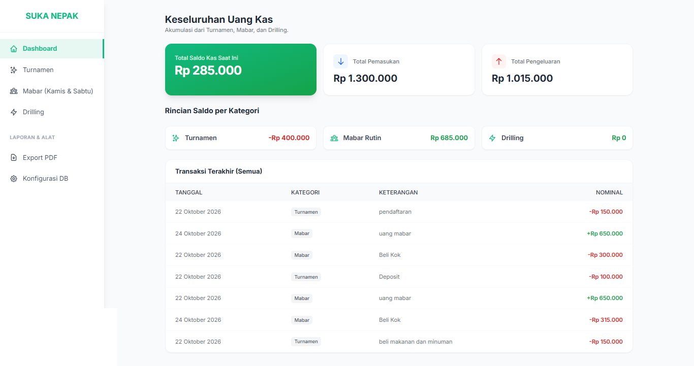
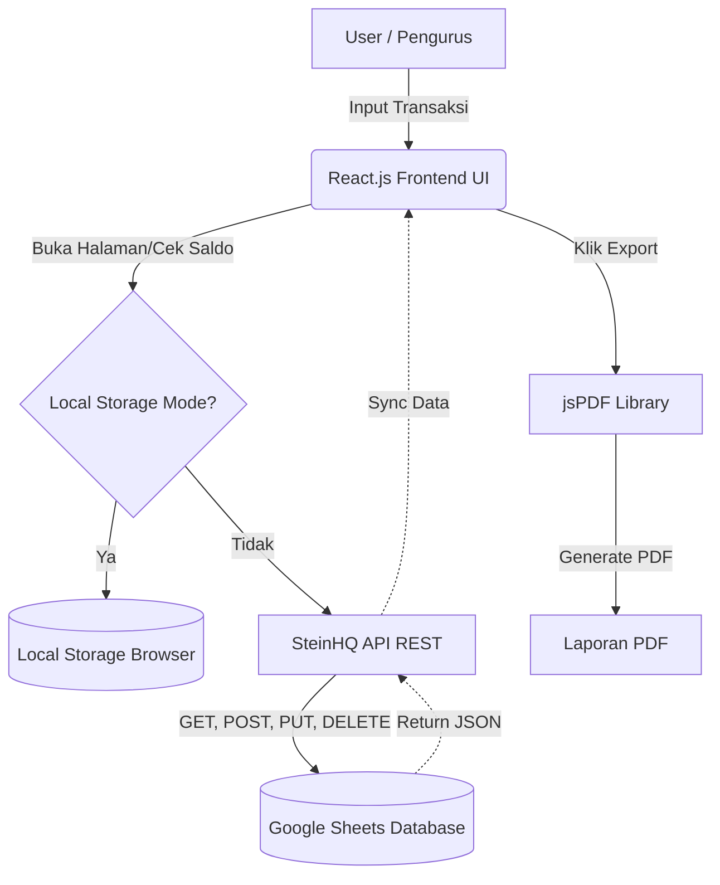

# 🏸 Dashboard Kas Badminton (PB. SmashKas)

Dashboard Kas Badminton adalah *Single Page Application* (SPA) berbasis web yang dirancang khusus untuk mempermudah pengurus komunitas/klub badminton dalam mencatat, melacak, dan melaporkan arus kas (pemasukan dan pengeluaran) secara transparan.




---

## 📑 Daftar Isi
1. [Fitur Utama](#-fitur-utama)
2. [Arsitektur & Alur Sistem](#-arsitektur--alur-sistem)
3. [Panduan Pengguna (User Guide)](#-panduan-pengguna-user-guide)
    - [Setup Database (Google Sheets)](#1-setup-database-google-sheets--steinhq)
    - [Cara Penggunaan](#2-cara-penggunaan-aplikasi)
4. [Panduan Developer (Developer Guide)](#-panduan-developer-developer-guide)
    - [Teknologi yang Digunakan](#teknologi-yang-digunakan)
    - [Struktur Kode](#struktur-kode)

---

## ✨ Fitur Utama

- 📊 **Dashboard Terpusat**: Memantau total kas keseluruhan dari seluruh kegiatan.
- 🏸 **Pemisahan Kategori**: Panel khusus untuk **Turnamen**, **Mabar (Rutin)**, dan **Drilling** agar pencatatan lebih spesifik.
- 🔄 **Sinkronisasi Saldo Real-time**: Saldo keseluruhan selalu tersinkronisasi di setiap halaman kategori.
- ☁️ **Database Google Sheets**: Data disimpan di Google Sheets melalui API SteinHQ, memudahkan pembacaan data secara visual oleh siapa saja.
- 💾 **Local Storage Fallback**: Dapat digunakan secara *offline* atau tanpa API untuk mencoba fitur (data tersimpan di memori browser).
- 📄 **Export Laporan PDF**: Unduh laporan keuangan secara Harian, Mingguan, Bulanan, atau rentang tanggal *Custom*.

---

## 🏗 Arsitektur & Alur Sistem

### Desain Sistem (System Architecture)



### Wireframe (Rancangan Tampilan)


---

## 👥 Panduan Pengguna (User Guide)

Aplikasi ini menggunakan **Google Sheets** sebagai tempat penyimpanan data Anda agar mudah diakses. Untuk menghubungkannya, kita menggunakan layanan gratis bernama **SteinHQ**.

### 1. Setup Database (Google Sheets & SteinHQ)

**Langkah 1: Siapkan Google Sheets**
1. Buka Google Sheets dan buat Spreadsheet baru (misal: "Keuangan Badminton").
2. Pastikan nama *Sheet* di tab bawah adalah **Sheet1** (huruf kapital 'S').
3. Pada baris pertama (A1 sampai F1), buat *Header* kolom persis seperti berikut (harus huruf kecil semua):
   `id` | `tanggal` | `kategori` | `tipe` | `nominal` | `keterangan`
   


**Langkah 2: Hubungkan ke SteinHQ**
1. Buka website [SteinHQ](https://steinhq.com/).
2. Login menggunakan akun Google Anda.
3. Klik **Create API**, lalu masukkan tautan (URL) dari Google Sheets yang baru saja Anda buat.
4. Anda akan mendapatkan URL API. Contohnya: `https://api.steinhq.com/v1/storages/64abcdef1234567890/Sheet1`
5. Salin URL tersebut.

**Langkah 3: Masukkan ke Aplikasi**
1. Buka aplikasi Dashboard Kas Badminton.
2. Klik tombol **Pengaturan DB** (ikon gir) di menu sebelah kiri.
3. Paste/tempel URL SteinHQ yang Anda salin tadi ke dalam kolom yang tersedia.
4. Klik **Simpan Pengaturan**.

> **Catatan:** Jika Anda tidak mengisi URL ini, aplikasi tetap bisa digunakan, namun data hanya akan tersimpan di HP/Laptop yang Anda gunakan (Local Storage) dan akan hilang jika Anda membersihkan *cache* browser.

### 2. Cara Penggunaan Aplikasi

* **Melihat Saldo:** Klik menu **Dashboard**. Anda bisa melihat ringkasan Pemasukan, Pengeluaran, dan Total Saldo.
* **Mencatat Transaksi:**
  1. Masuk ke kategori yang diinginkan (Turnamen, Mabar, atau Drilling).
  2. Klik tombol hijau **+ Catat Transaksi**.
  3. Pilih Tipe (Pemasukan/Pengeluaran), Kategori, Tanggal, Keterangan, dan Nominal.
  4. Klik **Simpan Transaksi**.
* **Mengedit Transaksi:** Klik ikon ✏️ (Pensil Biru) pada baris transaksi di tabel. Ubah data, lalu klik **Simpan Perubahan**.
* **Menghapus Transaksi:** Klik ikon 🗑️ (Tong Sampah Merah) pada baris transaksi di tabel. Konfirmasi penghapusan pada pop-up yang muncul.
* **Mencetak Laporan:**
  1. Klik menu **Export PDF**.
  2. Pilih rentang waktu (Harian, Mingguan, Bulanan, atau Custom).
  3. Klik **Download PDF**.

---

## 💻 Panduan Developer (Developer Guide)

Aplikasi ini dikembangkan dengan pendekatan *Single-File Component* agar mudah di-*host* (misal: Netlify, Vercel, atau Github Pages) tanpa perlu proses *build* yang kompleks bagi pemula.

### Teknologi yang Digunakan
- **Frontend Framework:** React 18 (via CDN)
- **Styling:** Tailwind CSS (via CDN)
- **Compiler JSX:** Babel Standalone (via CDN)
- **PDF Generator:** jsPDF & jsPDF-AutoTable
- **Backend/DB Service:** SteinHQ (Google Sheets as REST API)

### Menjalankan secara Lokal
Karena aplikasi ini dibangun dalam 1 file `.html`, Anda cukup:
1. Simpan file sebagai `index.html`.
2. Buka file tersebut dua kali (klik ganda) menggunakan browser apapun (Chrome, Safari, Edge, Firefox).
3. Anda tidak perlu menginstal Node.js, NPM, atau *web server* lokal untuk menjalankannya.

### Struktur Kode (Mental Model)

Semua kode berada di dalam `index.html`. Berikut adalah hierarki komponen utama:

```text
<App> (Komponen Utama yang mengelola State global: transactions, steinUrl)
 ├── <Sidebar> (Navigasi Desktop)
 ├── <Header> (Navigasi Mobile)
 ├── <MainContent>
 │    ├── <DashboardView> (Tampilan ringkasan & tabel 10 transaksi terakhir)
 │    └── <CategoryView> (Tampilan per kategori, filter data by kategori)
 ├── <BottomNav> (Navigasi Mobile di bawah layar)
 └── Modals
      ├── <AddTransactionModal> (Form Input/Edit Transaksi)
      ├── <ExportModal> (Logika jsPDF dan pemfilteran tanggal)
      ├── <SettingsModal> (Form input URL API SteinHQ)
      └── <ConfirmModal> (Dialog konfirmasi hapus data kustom)
```

### Manajemen State & Database
- **Load Data (`fetchData`):** Mengambil array dari SteinHQ. Memfilter baris kosong (jika ada *dirty rows* di Google Sheets).
- **Create/Update (`handleSaveTransaction`):** Menggunakan `POST` untuk data baru, dan `PUT` dengan payload `{ condition: { id: ... }, set: { ... } }` untuk SteinHQ.
- **Delete (`handleDelete`):** Menggunakan `DELETE` dengan payload `{ condition: { id: ... } }`.
- **Fallback:** Jika `steinUrl` kosong atau *fetch* gagal, sistem otomatis bergeser memanipulasi `localStorage.getItem('badminton_transactions')`.

---
*Dibuat untuk memajukan olahraga badminton komunitas! 🏸*