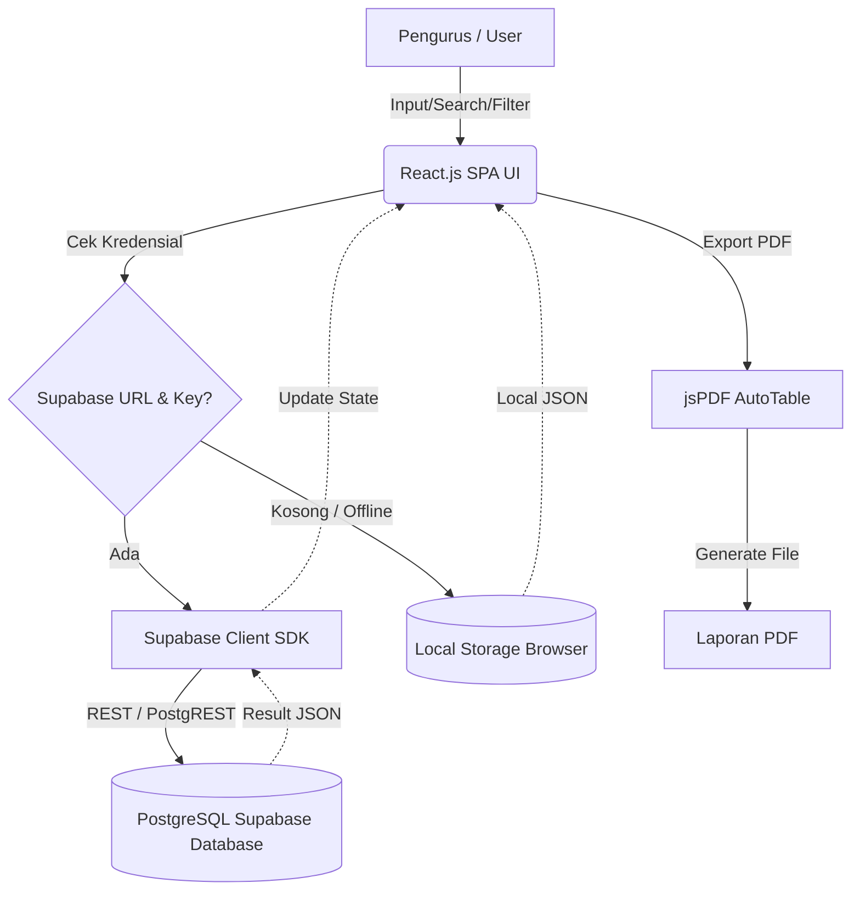

# 🏸 Dashboard Kas Badminton (PB. SmashKas) - Supabase Edition

Dashboard Kas Badminton adalah *Single Page Application* (SPA) berbasis web modern untuk komunitas/klub badminton dalam mengelola pemasukan dan pengeluaran kas secara terintegrasi, transparan, dan terstruktur.


---

## 📑 Daftar Isi
1. [Fitur Utama](#-fitur-utama)
2. [Konfigurasi Environment (.env)](#-konfigurasi-environment-env)
3. [Skema Database (SQL Supabase)](#-skema-database-sql-supabase)
4. [Arsitektur & Alur Sistem](#-arsitektur--alur-sistem)
5. [Panduan Pengguna (User Guide)](#-panduan-pengguna-user-guide)
6. [Panduan Developer (Developer Guide)](#-panduan-developer-developer-guide)

---

## ✨ Fitur Utama

- 📊 **Kas Utama & Sinkronisasi Global**: Kas disatukan di Dashboard Utama dan otomatis tersinkronisasi di setiap panel kategori.
- 🏸 **3 Kategori Pos Fokus**:
  - **Turnamen**: Pendaftaran, DP/deposit kok, konsumsi pemain & supporter.
  - **Mabar (Kamis & Sabtu)**: Member GOR, kebutuhan slop kok, dan jam tambahan.
  - **Drilling**: Latihan intensif & inventaris shuttlecock terpisah.
- ⚡ **Database PostgreSQL (Supabase)**: Koneksi langsung ke Supabase API tanpa keterbatasan Google Sheets/SteinHQ.
- 🔍 **Pencarian Multi-kriteria (Multi-field Search)**: Cari berdasarkan nama/keterangan, nominal, tanggal, tipe (pemasukan/pengeluaran), dan kategori.
- 📑 **Pagination Tabel**: Pengaturan jumlah baris per halaman (5, 8, 15, 30) dan navigasi halaman yang cepat.
- 📱 **Mobile Friendly UX**: Tampilan responsif dengan *Card List View* di HP dan *Table View* di desktop.
- 📄 **Export Laporan PDF**: Unduh laporan Keuangan Harian, Mingguan, Bulanan, atau Custom Range.

---

## 🔑 Konfigurasi Environment (.env)

Jika Anda mendeploy aplikasi ini menggunakan framework modern (seperti Vite, Next.js, atau React CLI), buat file `.env` di root proyek Anda dengan format berikut:

```env
# Supabase Configuration
VITE_SUPABASE_URL=https://your-project-ref.supabase.co
VITE_SUPABASE_ANON_KEY=eyJhbGciOiJIUzI1NiIsInR5cCI6IkpXVCJ9...
```

> **Catatan untuk Mode Single-File SPA:** Pada file `index.html`, Anda dapat memasukkan *URL* dan *Anon Key* ini secara langsung melalui modal **Config Supabase** (Ikon Gir/Database) di dalam aplikasi. Data kredensial tersimpan aman di browser Anda.

---

## 🗄️ Skema Database (SQL Supabase)

Jalankan perintah SQL berikut di **SQL Editor** pada Dashboard Supabase Anda (`https://supabase.com`):

```sql
-- 1. Buat Tabel Transaksi
CREATE TABLE public.transactions (
    id UUID DEFAULT gen_random_uuid() PRIMARY KEY,
    tanggal DATE NOT NULL DEFAULT CURRENT_DATE,
    kategori VARCHAR(50) NOT NULL CHECK (kategori IN ('Turnamen', 'Mabar', 'Drilling')),
    tipe VARCHAR(20) NOT NULL CHECK (tipe IN ('Pemasukan', 'Pengeluaran')),
    nominal NUMERIC(15, 2) NOT NULL CHECK (nominal >= 0),
    keterangan TEXT NOT NULL,
    created_at TIMESTAMP WITH TIME ZONE DEFAULT TIMEZONE('utc'::text, NOW()) NOT NULL
);

-- 2. Buat Indexing untuk Performa Query Cepat
CREATE INDEX idx_transactions_tanggal ON public.transactions(tanggal DESC);
CREATE INDEX idx_transactions_kategori ON public.transactions(kategori);
CREATE INDEX idx_transactions_tipe ON public.transactions(tipe);

-- 3. Aktifkan Row Level Security (RLS)
ALTER TABLE public.transactions ENABLE ROW LEVEL SECURITY;

-- 4. Buat Kebijakan Akses (Policy) untuk Anon Key (Read & Write)
CREATE POLICY "Public Anon Access" ON public.transactions
    FOR ALL 
    USING (true) 
    WITH CHECK (true);
```

---

## 🏗 Arsitektur & Alur Sistem



---

## 👥 Panduan Pengguna (User Guide)

### 1. Hubungkan ke Supabase
1. Buka [Supabase.com](https://supabase.com/) dan buat project baru.
2. Jalankan perintah di bab [Skema Database](#-skema-database-sql-supabase) di SQL Editor Supabase.
3. Buka menu **Project Settings > API** di Supabase.
4. Salin **Project URL** dan **anon public key**.
5. Di aplikasi Dashboard Kas, klik menu **Config Supabase** di sidebar/header, lalu paste kredensial tersebut dan klik **Simpan & Koneksikan**.

### 2. Menggunakan Fitur Pencarian & Pagination
- **Pencarian (Search):** Ketik kata kunci pada kolom cari di atas tabel. Sistem akan mencari pada keterangan, tanggal, atau nominal secara real-time.
- **Filter:** Pilih opsi pada dropdown kategori, tipe (pemasukan/pengeluaran), atau tanggal mulai & akhir.
- **Pagination:** Gunakan tombol navigasi di bagian bawah tabel untuk berpindah halaman atau ubah baris data yang tampil per halaman.

---

## 💻 Panduan Developer (Developer Guide)

### Teknologi Utama
- **Frontend Engine:** React 18 + Babel Standalone
- **Styling:** Tailwind CSS
- **Database Backend:** Supabase (PostgreSQL) + `@supabase/supabase-js` (via CDN)
- **PDF Export Engine:** jsPDF & jsPDF-AutoTable

### Struktur File Single Page App (`index.html`)

```text
index.html
 ├── App (Main State Management: transactions, filters, supabaseClient)
 ├── DashboardView (Ringkasan Kas Utama & statistik per kategori)
 ├── CategoryView (Panel Khusus: Turnamen, Mabar, Drilling + Synced Total)
 ├── TransactionTableWithFilter (Reusable Filter + Search + Pagination Component)
 └── Modals
      ├── AddTransactionModal (Form Tambah / Edit Transaksi)
      ├── ExportModal (Export Laporan Keuangan PDF)
      ├── SettingsModal (Form Input URL & Anon Key Supabase)
      └── ConfirmModal (Pop-up Hapus Data)
```

---
*Dikembangkan untuk Komunitas Badminton Indonesia 🏸*